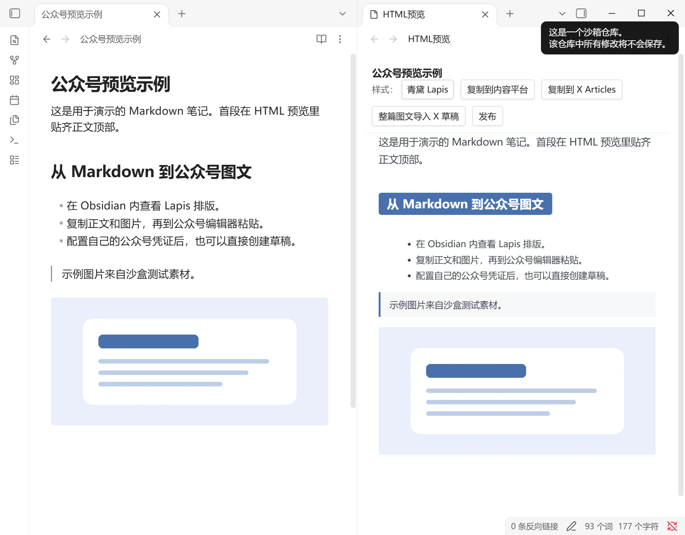
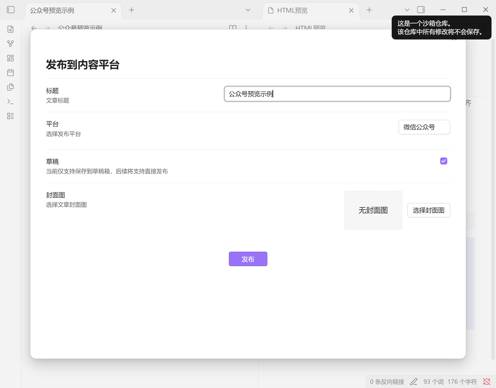

# Enhanced Publisher for Obsidian

**Enhanced Publisher 是直接安装到 Obsidian 的社区插件。** 打开 Markdown 笔记后，就能在 Obsidian 里查看公众号排版、复制图文，或将文章保存到公众号草稿箱。

这个版本基于 [cube 的 Enhanced Publisher 1.2.0](https://github.com/chararch/obsidian-enhanced-publisher)，加入了首段贴顶、预览跟随所选笔记、WebP 图片复制兼容、SVG 动效预览和 X Articles 支持。

## 截图

**Obsidian 双栏预览。** 左侧是示例笔记，右侧是青黛 Lapis 的公众号 HTML 预览。顶部可以切换样式、复制图文或打开草稿窗口。正文首段贴齐预览区域顶部。

**公众号草稿窗口。** 可以填写标题、选择封面，并将文章保存到草稿箱。

## 安装

1. 从 [GitHub Releases](https://github.com/hi-nikola/obsidian-enhanced-publisher/releases) 下载 `enhanced-publisher.zip` 并解压。
2. 把解压后的整个 `enhanced-publisher` 文件夹放进你的 Obsidian 笔记库的 `.obsidian/plugins/`。安装后应能找到 `.obsidian/plugins/enhanced-publisher/manifest.json`。
3. 在 Obsidian 的 **设置 → 第三方插件** 中启用 **Enhanced Publisher**。如列表未更新，重开笔记库。
4. 已装过同名插件时，先停用旧版本，保留文件夹内自己的 `data.json`，再覆盖运行文件并重新启用。

安装包已内置插件代码、样式和 X Articles 中转模块。解压后可直接使用，无需构建或安装 Node.js。

## 使用

- **预览公众号排版。** 打开一篇笔记，在命令面板执行 **Enhanced Publisher: 以HTML形式预览**，也可右键 Markdown 文件打开预览。
- **复制图文。** 点击预览栏的 **复制到内容平台**，再粘贴到公众号编辑器。预览和复制无需公众号凭证。
- **保存公众号草稿。** 在插件设置中填入自己的公众号 AppID 和 AppSecret。点击预览栏的 **发布**，选择封面并提交草稿。正式发表在公众号后台操作。
- **整理粘贴图片。** 启用自动保存后，粘贴的图片会写入当前笔记的附件目录，并在笔记中插入引用。
- **使用 X Articles。** 可复制图文。整篇导入 X 草稿需要 Obsidian 桌面版、安装 Kaitox 扩展的 Chrome 或 Edge，以及已登录的 X 账号。

## 验证与隐私

安装包已在 Windows 的 Obsidian 1.15.0 沙盒中验证启用、切换文章、首段贴顶、本地图像预览、图文复制和粘贴图片自动保存。公众号草稿流程使用模拟返回验证，X Articles 验证了导入窗口和本机中转。真实账号上传需要使用者自己的平台权限。移动端和其他桌面平台尚未实测。

安装包只含运行文件与许可，公众号凭证、`data.json`、笔记和历史备份均不随包分发。截图来自专门创建的沙盒示例。

原插件采用 [MIT 许可](LICENSE)。打包保留了[依赖许可](enhanced-publisher/licenses/)和 [X Articles 第三方声明](enhanced-publisher/X_ARTICLES_THIRD_PARTY_NOTICES.md)。
